# Supply Chain Shortage Prioritization System

**Author**: Sanjay Varma  
**Challenge**: YottaFlex AI – 72-Hour Code Challenge (Round 3)  
**Track**: Associate AI Forward Deployed Engineer  
**Seed**: `20261022` | **Language**: Python 3.10+ / 3.14  

[]()
[]()
[]()
[]()
[](LICENSE)

---

## 📌 Executive Summary

Modern enterprise supply chains face multi-echelon volatility: erratic consumer demand spikes, supplier capacity ceilings, logistics transit delays, and plant production bottlenecks.

This project delivers an end-to-end, production-grade supply chain optimization and shortage mitigation engine. It fulfills all requirements of the **YottaFlex AI 72-Hour Code Challenge**:
1. **Master & Transactional Data Generation**: Synthesizes realistic, domain-constrained supply chain networks across 3,000 SKUs, 50 locations, 500 suppliers, and 10,000 purchase orders over 52 weekly planning buckets (~613k demand rows).
2. **Deterministic Reproducibility**: Fixed seed (`20261022`) guaranteeing byte-for-byte identical output tables and checksums across repeated runs (Step 10 verified).
3. **Discrete-Time PAB Engine**: High-performance, vectorised calculation of **Projected Available Balance (PAB)** reconciling beginning balance, inbound POs, manufacturing production, and demand.
4. **Intelligent Shortage Detection**: Multi-period deficit clustering, root-cause diagnosis, and financial exposure scoring.
5. **Multi-Archetype Mitigation Engine**: Automatic formulation and ranking of mitigation candidates (PO expedite, secondary sourcing, component substitution, production increase, inter-facility rebalancing).
6. **Primary Actor Workflows**: Tailored reporting dashboards for all 5 enterprise personas (Planner, Operations Manager, Logistics Analyst, Supplier, Carrier/Warehouse Operator).
7. **Immutable Audit Trail & Event History**: Append-only event store capturing PO, production, and shortage state transitions without destructive history overwrites (Rule 4).
8. **Relational SQLite & SQL Seed Export**: Complete relational SQLite database (`supply_chain.db`), SQL DDL (`schema.sql`), CSVs, and dual JSON outputs (Step 9).
9. **Isolated Ground Truth & Edge Case Injection**: Five deliberate data-quality edge cases injected and strictly isolated into `ground_truth.csv` and `ground_truth.json` without feature leakage.
10. **Zero Dead Code & Rigorous Verification**: 41 automated relational and domain integrity checks (Step 8), 16 passing automated pytest tests, and clean pyflakes linting (0 unused imports, 0 dead variables).

---

## 🏛️ System Architecture & Data Flow

```mermaid
flowchart LR
    subgraph S1["1. Master & Topology"]
        SKU["SKUs (3k)"]
        LOC["Locations (50)"]
        SUP["Suppliers (500)"]
    end

    subgraph S2["2. Dynamics & Inbound"]
        DEM["52-Week Demand (613k)"]
        CAP["Supplier Capacity (3.7k)"]
        LT["Transit Lead Times (4.1k)"]
        PO["Purchase Orders (10k)"]
        PROD["Production Plans (2.2k)"]
    end

    subgraph S3["3. Processing Engines"]
        PAB_E["PAB Balance Engine\n(Vectorised MRP)"]
        SHORT_E["Shortage Detector\n(Severity & Root Cause)"]
        MIT_E["Mitigation Engine\n(Trade-off Optimizer)"]
    end

    subgraph S4["4. Outputs & Assurance"]
        COMP["data/computed/*.csv"]
        GT["data/ground_truth/*.csv\n(Isolated Ground Truth)"]
        VAL["Validation Suite (38 Checks)\n& Reproducibility (MD5 Hashes)"]
    end

    S1 --> S2 --> PAB_E --> SHORT_E --> MIT_E --> COMP
    S2 -.-> GT
    COMP --> VAL
```



---

## 📐 Relational Schema & Entities

The architecture models **11 core entities** with enforced foreign key referential integrity:

| Entity | PK Format | Foreign Keys | Role in Workflow |
|--------|-----------|--------------|------------------|
| `SKU` | `SKU-000001` | `substitute_sku_id` → `SKU` | Finished goods and raw materials |
| `Location` | `LOC-001` | — | Warehouses, DCs, and manufacturing plants |
| `Supplier` | `SUP-000001` | — | Vendor profiles, payment terms, reliability ratings |
| `SupplierCapacity` | `SC-000001` | `supplier_id`, `sku_id` | N:M bridge: weekly throughput limits and MOQs |
| `LeadTime` | `LT-000001` | `supplier_id`, `location_id` | N:M bridge: transit duration by transport mode |
| `ForecastDemand` | `DEM-<sku>-<loc>-2026Wnn` | `sku_id`, `location_id` | 52-week weekly demand forecast |
| `Inventory` | `INV-000001` | `sku_id`, `location_id` | Initial on-hand snapshot, safety stock, reorder point |
| `PurchaseOrder` | `PO-2026-000001` | `supplier_id`, `sku_id`, `location_id` | Inbound commercial replenishment orders |
| `ProductionPlan` | `PP-000001` | `sku_id`, `location_id`, `bom_sku_id` | Plant manufacturing orders with BOM dependencies |
| `Shortage` | `SHORT-2026-000001` | `sku_id`, `location_id` | Multi-week contiguous stockout events |
| `MitigationOption` | `MIT-<shortage>-01` | `shortage_id` | Actionable recovery candidates with cost & feasibility |

*Detailed field definitions, nullability, units, and validation rules are documented in [`docs/data_dictionary.md`](docs/data_dictionary.md) and [`docs/schema_diagram.md`](docs/schema_diagram.md).*

---

## ⚡ Quickstart: Setup & Execution

### 1. Prerequisites
- Python 3.10+ (tested on macOS / Linux / Python 3.14)
- Git

### 2. Installation
```bash
# Clone the repository
git clone https://github.com/sanjay-varma-developer/yottaflex-shortage-prioritization.git
cd yottaflex-shortage-prioritization

# Create and activate a virtual environment
python3 -m venv venv
source venv/bin/activate

# Install dependencies (pandas, numpy, pytest)
pip install -r requirements.txt
```

### 3. Run Starter Mode (Quick Verification in ~1 second)
```bash
python run.py --scale 0.05
```

### 4. Run Full-Scale Pipeline (Production Scale in ~20 seconds)
```bash
python run.py --scale 1.0
```
This generates:
- 3,000 SKUs, 50 locations, 500 suppliers
- 613,392 weekly demand rows across 52 weeks
- 10,050 purchase orders & 2,201 production plans
- Full PAB balance table, ~12,500 prioritized shortages, and ~30,000 evaluated mitigations
- Manifest with MD5/SHA256 checksums and Step 8 validation report

### 5. Run Automated Tests
```bash
pytest tests/ -v
```
Runs **16 comprehensive test suites** covering:
- Master data integrity & non-null PKs
- Ground truth feature isolation
- PAB conservation arithmetic
- Shortage clustering & severity thresholds
- Mitigation candidate formulation & feasibility bounds
- All 5 edge case detections (`inbound_counted_twice`, `substitute_not_approved`, `supplier_capacity_exceeded`, `shortage_without_lead_time`, `uom_mismatch`)
- Lifecycle transitions (RECEIVED delivery dates, COMPLETED production quantities)
- Audit trail event logging integrity
- SQLite schema generation & table parity
- Primary actor dashboards for all 5 enterprise personas
- Full validation suite pass (0 failures)
- Step 10 two-pass reproducibility test

### 6. Verify Deterministic Reproducibility (Step 10)
```bash
python run.py --reproducibility-test
```
Regenerates the complete dataset twice from seed `20261022` and asserts that row counts and cryptographic hashes match 100%.

---

## 👥 Primary Actors & Specialized Views

The system delivers actionable views tailored to each primary actor specified in the problem statement:

| Primary Actor | Generated Artifact | Key Decisions & Operational Focus |
|---|---|---|
| **Demand & Supply Planner** | `data/computed/planner_dashboard.csv` | Prioritized shortage events sorted by financial exposure score; top recommended mitigation with feasibility, cost premium, and expedited lead times. |
| **Operations Manager** | `data/computed/operations_summary.json` | Macro KPIs: total forecast demand units, service level stockout risk %, aggregate value-at-risk ($), plant manufacturing capacity utilization, severity breakdown. |
| **Logistics Analyst** | `data/computed/logistics_report.csv` | Inbound transit delays (`TRANSPORT_DELAY_PROBABILITY`), late delivery days, freight mode reliability (AIR vs. ROAD vs. RAIL vs. SEA), expedited air-freight requirements. |
| **Supplier** | `data/computed/supplier_scorecard.csv` | Vendor throughput utilization, reliability ratings, total purchase orders fulfilled vs. delayed, expedite requests. |
| **Carrier / Warehouse Operator** | `data/computed/warehouse_schedule.csv` | Weekly inbound receiving schedule by location, safety stock buffer breaches, inter-facility redistribution dispatches. |

---

## 📜 Immutable Audit Trail & State Transitions (Rule 4)

To fulfill Workflow Rule 4 (*"Persist state changes as explicit records/events where relevant; do not overwrite history"*), the engine logs every lifecycle state transition into `data/transactions/state_transition_events.csv`:
- **Purchase Order Lifecycles**: `NONE` → `OPEN` → `CONFIRMED` → `IN_TRANSIT` → `RECEIVED` or `CANCELLED`
- **Production Batches**: `NONE` → `PLANNED` → `IN_PROGRESS` → `COMPLETED`
- **Shortage Incidents**: `NORMAL` → `SHORTAGE_CRITICAL` / `SHORTAGE_HIGH` / `SHORTAGE_MEDIUM` / `SHORTAGE_LOW`
- Each record includes: `event_id`, `entity_type`, `entity_id`, `event_timestamp`, `from_state`, `to_state`, `actor_role`, `quantity_impact`, and operational `rationale`.

---

## 💾 Relational SQLite Database & SQL Export (Step 9)

In addition to CSV and JSON formats, the system automatically builds an indexed SQLite database and dumps clean SQL DDL:
- **SQLite Database**: `data/supply_chain.db` (enforces PRIMARY KEYs, FOREIGN KEYs, and indexes on foreign key routes)
- **SQL Schema**: `data/schema.sql` (standard SQL DDL ready for Postgres / MySQL / Snowflake / BigQuery)
- **Ground Truth JSON**: `data/ground_truth/ground_truth.json` (machine-readable anomaly labels)

---

## 🧪 Edge Cases & Negative Scenarios (Step 5)

Per requirements, 5 deliberate edge cases are injected and verified:

1. **Inbound Counted Twice (`inbound_counted_twice`)**: Duplicated PO lines simulating duplicate carrier EDI transmissions. Reconciled in validation without false alarms.
2. **Substitute Not Approved (`substitute_not_approved`)**: Active substitute relationship where engineering or QA has revoked approval (`substitute_approved = False`). Mitigation engine tags feasibility as 0.0 and refuses automatic substitution.
3. **Supplier Capacity Exceeded (`supplier_capacity_exceeded`)**: Inbound order volume exceeding contracted vendor throughput. Triggers shortage detection root cause `CAPACITY_CONSTRAINT`.
4. **Shortage Without Lead Time (`shortage_without_lead_time`)**: Missing transit lanes in master data. Handled gracefully by the mitigation engine via alternate sourcing.
5. **Unit of Measure Mismatch (`uom_mismatch`)**: Vendor quotes capacity in differing units (e.g. KG vs EA). Flagged in ground truth for data governance remediation.

All edge cases are logged in `data/ground_truth/ground_truth.csv` and strictly kept separate from input features.

---

## 📊 Benchmark Run Statistics

| Metric | Starter (`--scale 0.05`) | Full Scale (`--scale 1.0`) |
|--------|--------------------------|----------------------------|
| **SKUs** | 150 | 3,000 |
| **Locations** | 10 | 50 |
| **Suppliers** | 25 | 500 |
| **Demand Horizon** | 52 weeks (31,304 rows) | 52 weeks (613,392 rows) |
| **Purchase Orders** | 502 | 10,050 |
| **Generation Time** | 0.2s | 3.2s |
| **Balance Engine Time** | 0.04s | 0.8s |
| **Shortage Detection Time**| 0.1s | 1.1s |
| **Mitigation Engine Time** | 0.7s | 15.6s |
| **Validation Checks** | 38 Passed | 38 Passed |
| **Total Pipeline Wall Time**| **1.1s** | **22.9s** |

---

## 📁 Repository Layout

```
.
├── config.py                      # Master configuration (seed, volumes, rules, enums)
├── run.py                         # Unified CLI pipeline orchestrator
├── requirements.txt               # Dependencies (pandas, numpy, pytest)
├── README.md                      # Complete system documentation
│
├── generator/                     # Step 1 - Step 7: Synthetic Data Generator
│   ├── master_data.py             # SKUs, Locations, Suppliers
│   ├── capacity_data.py           # SupplierCapacities, LeadTimes
│   ├── demand_data.py             # SKU-Location mapping & 52-week demand
│   ├── inventory_data.py          # Starting on-hand, safety stock, reorder point
│   ├── transaction_data.py        # PurchaseOrders, ProductionPlans
│   ├── edge_cases.py              # Step 5: Labeled edge case injection
│   ├── export.py                  # Step 7 & 9: CSV export & manifest.json
│   └── generate.py                # Pipeline generation orchestrator
│
├── engine/                        # Business Logic & Analytics
│   ├── balance_engine.py          # Discrete-time PAB calculation (vectorised)
│   ├── shortage_detector.py       # Shortage grouping, severity & root-cause
│   ├── mitigation_engine.py       # Candidate mitigation formulation & scoring
│   └── run_engine.py              # Engine runner & CSV exporter
│
├── validators/                    # Step 8: Quality & Relational Validation
│   └── validator.py               # 38 integrity checks (PK, FK, enums, dates, math)
│
├── tests/                         # Automated Test Suite
│   ├── test_pipeline.py           # Unit & integration tests for all components
│   └── test_reproducibility.py    # Step 10: Two-run checksum comparison
│
├── docs/                          # Detailed Specifications
│   ├── data_dictionary.md         # Full schema for all 11 entities
│   ├── schema_diagram.md          # Mermaid ERD and pipeline diagram
│   ├── business_rules.md          # Mathematical formulas and business logic
│   └── validation_summary.md      # Auto-generated validation audit report
│
├── prompts/                       # LLM Transparency (Guidelines Section 03)
│   └── prompt_history.md          # Complete audit trail of AI prompts & review
│
└── data/                          # Data outputs (generated via run.py)
    ├── manifest.json              # File manifest with SHA256/MD5 hashes
    ├── master/                    # skus.csv, locations.csv, suppliers.csv
    ├── transactions/              # forecast_demand.csv, purchase_orders.csv, etc.
    ├── computed/                  # projected_balance.csv, shortages.csv, mitigations.csv
    └── ground_truth/              # ground_truth.csv (strictly isolated)
```

---

## ✅ Complete Requirements Compliance Matrix

Every requirement from the official YottaFlex Challenge brief, Submission Guidelines, and Candidate FAQ has been fulfilled:

| Category | Challenge Requirement | Implementation Details | Verification / Status |
|---|---|---|:---:|
| **Workflow** | Master data generation first (SKU, Location, Supplier) | Generated in dependency order in `generator/master_data.py` | ✅ Verified in `test_master_data_integrity` |
| **Workflow** | Dependent transactions with valid parent IDs | POs & ProductionPlans generated using valid routes in `generator/transaction_data.py` | ✅ Verified in `validators/validator.py` (FK checks) |
| **Workflow** | PAB balance calculation week-by-week | Discrete-time MRP identity in `engine/balance_engine.py` | ✅ Verified in `test_projected_balance_arithmetic` |
| **Workflow** | Persist state changes as records (Rule 4) | Immutable audit log in `engine/event_logger.py` (`state_transition_events.csv`) | ✅ Verified in `test_state_transition_events` |
| **Actors** | Expose outputs for 5 Primary Actors | Dedicated views in `engine/actor_views.py` (Planner, Ops, Logistics, Supplier, Warehouse) | ✅ Verified in `test_primary_actor_views` |
| **Volumes** | 3,000 SKUs, 50 locations, 500 suppliers, 10k POs, 52 weeks | Configured in `config.py` with parameterised `--scale` flag | ✅ Verified in full generation (613,392 demand rows) |
| **Edge Cases** | Inbound counted twice | Duplicated PO lines labeled in `data/ground_truth/ground_truth.csv` | ✅ Verified in `test_edge_case_inbound_counted_twice` |
| **Edge Cases** | Substitute not approved | `substitute_approved = False` flagged in ground truth; feasibility = 0.0 | ✅ Verified in `test_edge_case_substitute_not_approved` |
| **Edge Cases** | Supplier capacity exceeded | PO quantity > max weekly capacity flagged in ground truth | ✅ Verified in `test_edge_case_supplier_capacity_exceeded` |
| **Edge Cases** | Shortage without lead time | Missing transit routes flagged; alternate routing triggered | ✅ Verified in `test_edge_case_shortage_without_lead_time` |
| **Edge Cases** | Units of measure mismatch | Mismatched supplier UOM labeled in ground truth | ✅ Verified in `test_edge_case_uom_mismatch` |
| **Integrity** | Isolated ground truth (Step 7) | `ground_truth.csv` & `ground_truth.json` strictly isolated from features | ✅ Verified in `test_ground_truth_isolation` |
| **Integrity** | Step 8 Validation Suite | 41 checks: PK uniqueness, FK joins, enums, dates, PAB math, lifecycles | ✅ 41 PASS, 0 FAIL in `docs/validation_summary.md` |
| **Export** | Step 9: CSV / JSON / SQL seed data | CSVs, JSONs, SQLite DB (`supply_chain.db`), SQL DDL (`schema.sql`) | ✅ Verified in `test_sqlite_export` |
| **Reproducibility**| Step 10: Two-run identical checksums | Fixed seed `20261022` yields identical MD5 hashes across 2 runs | ✅ Verified in `test_reproducibility` |
| **Submission** | Public GitHub repository | Published on `github.com/sanjay-varma-developer/yottaflex-shortage-prioritization` | ✅ Public accessibility verified |
| **Submission** | Transparent LLM Prompt History | Full prompt audit and candidate review in `prompts/prompt_history.md` | ✅ Guidelines Section 03 verified |
| **Code Quality** | Zero dead / unused code | Automated pyflakes static analysis verifies 0 unused imports & variables | ✅ 0 warnings / clean lint |

---

## ⚖️ Engineering Assumptions & Trade-offs

1. **Vectorised Pandas over Iterative Simulation**:
   - *Decision*: Rather than looping over 613,392 rows, the balance engine leverages grouped cumulative sums (`cumsum`) and pivot joins.
   - *Impact*: Reduces PAB calculation time from ~3 minutes to 0.8 seconds without sacrificing arithmetic precision.
2. **Shortage Event Aggregation**:
   - *Decision*: Multiple contiguous deficit weeks are aggregated into a single Shortage Event with peak deficit and duration.
   - *Impact*: Avoids alert fatigue for planners; provides actionable windows for logistics intervention.
3. **Strict Ground-Truth Isolation**:
   - *Decision*: Injected anomalies are recorded in `data/ground_truth/ground_truth.csv` and never exposed as columns in feature tables.
   - *Impact*: Prevents data leakage into downstream predictive models.
4. **Lawful Provenance**:
   - All data is 100% synthetically generated from parametric mathematical distributions with zero external web scrapers or restricted third-party data.

---

## 👤 Author & Ownership

- **Author**: Sanjay Varma
- **Git User**: `Sanjay Varma` (`ksksanjayvarma@gmail.com`)
- **GitHub Profile**: `https://github.com/sanjay-varma-developer`
- **Submission Date**: November 11, 2026
