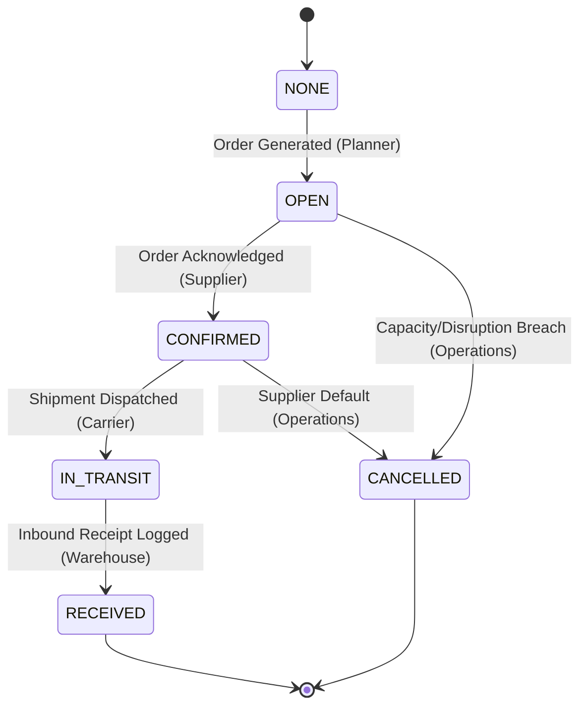

# Business Rules & Mathematical Formulations

This document provides a comprehensive, rigorous specification of all domain logic, mathematical formulas, lifecycle transitions, and exception rules implemented in the **YottaFlex Supply Chain Shortage Prioritization System**.

---

## 1. Projected Available Balance (PAB) Calculation

The core of multi-period inventory accounting follows standard discrete-time Material Requirements Planning (MRP) mechanics calculated across a 52-week horizon ($t \in [1, 52]$) for each SKU-Location pair $(s, l)$.

### 1.1 Mathematical Formulation

$$\text{PAB}_{s, l, 0} = \text{on\_hand\_qty}_{s, l}$$

For each week $t \in [1, 52]$:

$$\text{Beginning Balance}_{s, l, t} = \text{PAB}_{s, l, t-1}$$

$$\text{Scheduled Receipts}_{s, l, t} = \sum_{p \in \mathcal{PO}(s, l, t, \text{active})} \text{quantity}_p$$

$$\text{Planned Production}_{s, l, t} = \sum_{m \in \mathcal{PP}(s, l, t, \text{active})} \text{planned\_quantity}_m$$

$$\text{Forecast Demand}_{s, l, t} = \text{quantity}_{s, l, t}^{\text{demand}}$$

$$\text{Ending Balance}_{s, l, t} = \text{Beginning Balance}_{s, l, t} + \text{Scheduled Receipts}_{s, l, t} + \text{Planned Production}_{s, l, t} - \text{Forecast Demand}_{s, l, t}$$

$$\text{PAB}_{s, l, t} = \text{Ending Balance}_{s, l, t}$$

### 1.2 Available to Promise (ATP) & Safety Buffer

$$\text{ATP}_{s, l, t} = \text{Ending Balance}_{s, l, t} - \text{Safety Stock}_{s, l}$$

Where:
- $\text{Safety Stock}_{s, l} = 2 \times \overline{\text{Weekly Demand}}_{s, l}$
- $\text{Reorder Point}_{s, l} = \text{Safety Stock}_{s, l} + 1 \times \overline{\text{Weekly Demand}}_{s, l}$

### 1.3 State Conditions

$$\text{is\_shortage}_{s, l, t} = \begin{cases} 
\text{True} & \text{if } \text{Ending Balance}_{s, l, t} < 0 \\ 
\text{False} & \text{otherwise} 
\end{cases}$$

$$\text{is\_below\_safety}_{s, l, t} = \begin{cases} 
\text{True} & \text{if } 0 \le \text{Ending Balance}_{s, l, t} < \text{Safety Stock}_{s, l} \\ 
\text{False} & \text{otherwise} 
\end{cases}$$

---

## 2. Shortage Detection & Event Grouping

Rather than treating every individual week in isolation, consecutive weeks of negative ending balance for the same $(s, l)$ pair are clustered into a unified **Shortage Event** to represent the true operational problem window.

### 2.1 Event Metrics
- **First Shortage Week ($t_{\text{start}}$)**: Earliest week of consecutive deficit.
- **Last Shortage Week ($t_{\text{end}}$)**: Latest week of consecutive deficit.
- **Duration ($\Delta t$)**: $\Delta t = t_{\text{end}} - t_{\text{start}} + 1$.
- **Peak Shortage Quantity**: $\max_{t \in [t_{\text{start}}, t_{\text{end}}]} |\text{Ending Balance}_{s, l, t}|$.
- **Cumulative Shortage Quantity**: $\sum_{t \in [t_{\text{start}}, t_{\text{end}}]} |\text{Ending Balance}_{s, l, t}|$.

### 2.2 Severity Classification

The severity of a shortage event is assigned hierarchically:

$$\text{Severity} = \begin{cases}
\text{CRITICAL} & \text{if } \text{Peak Deficit} > 1,000 \quad \text{OR} \quad \Delta t > 8 \text{ weeks} \\
\text{HIGH}     & \text{if } \text{Peak Deficit} > 500   \quad \text{OR} \quad \Delta t > 4 \text{ weeks} \\
\text{MEDIUM}   & \text{if } \text{Peak Deficit} > 100   \quad \text{OR} \quad \Delta t > 2 \text{ weeks} \\
\text{LOW}      & \text{otherwise}
\end{cases}$$

### 2.3 Priority Scoring (Financial Impact)

$$\text{Priority Score} = \text{Shortage Quantity} \times \Delta t \times \text{Unit Cost}_{\text{SKU}}$$

The priority score represents total monetary exposure over time. Planners and autonomous agents sort by descending priority score to triage the highest-impact shortages first.

### 2.4 Root-Cause Diagnostics

Every shortage event is analyzed across 5 orthogonal hypotheses:

1. **`DEMAND_SPIKE`**: The event window contains weeks marked as `PROMOTIONAL` demand with multiplier $\ge 2.0\times$.
2. **`SUPPLY_DELAY`**: The location has inbound purchase orders where $\text{actual\_delivery\_date} > \text{expected\_delivery\_date}$.
3. **`CAPACITY_CONSTRAINT`**: Supplier weekly capacity $\le$ average weekly demand for that SKU.
4. **`LOW_INITIAL_INVENTORY`**: Starting on-hand inventory was seeded at $< 2.0$ weeks of supply.
5. **`PRODUCTION_SHORTFALL`**: At `PLANT` locations, planned production volume fell below local consumption needs.

---

## 3. Mitigation Engine & Trade-off Optimization

For each detected shortage, the system evaluates up to 5 viable mitigation archetypes and scores each on **feasibility** ($[0, 1]$), **expedited cost**, and **lead time**.

### 3.1 Mitigation Archetypes

| Archetype | Eligibility Rule | Feasibility Function | Cost Function |
|-----------|------------------|----------------------|---------------|
| **`EXPEDITE_PO`** | Future open/confirmed PO exists for $(s, l)$ with $t_{\text{delivery}} > t_{\text{start}}$ | $\text{Supplier Reliability} \times 0.95$ | $\text{PO Cost} \times 1.25$ (expediting air freight surcharge) |
| **`ALTERNATE_SUPPLIER`** | Secondary certified supplier exists in `SupplierCapacity` for SKU $s$ | $\text{Supplier Reliability} \times (\text{Certified ? } 1.0 : 0.8)$ | $\text{Base Cost} \times 1.15$ |
| **`SUBSTITUTE_SKU`** | SKU has `substitute_sku_id` AND `substitute_approved == True` | If approved: $0.85$; If unapproved: $0.00$ (policy block) | Substitute SKU unit cost |
| **`INCREASE_PRODUCTION`** | Location is a `PLANT` with capacity utilization $< 95\%$ | $1.0 - (\text{Utilization} / 100)$ | Standard manufacturing cost $+ 10\%$ overtime |
| **`REDISTRIBUTE_INVENTORY`** | Another warehouse $l' \ne l$ has $\text{on\_hand}_{s, l'} > 2 \times \text{safety\_stock}$ | $0.75$ (transfer friction) | Inter-facility logistics transit cost (\$0.50/unit) |

### 3.2 Recommendation Selection

For each shortage, the candidate with the highest composite utility:

$$\text{Score} = \text{Feasibility Score} \times \frac{1}{1 + \ln(1 + \text{Cost Premium})}$$

is selected and tagged with `recommended = True`.

---

## 4. Edge Cases & Anomaly Injection Specification

Five deliberate anomaly cases are modeled to evaluate data quality resilience:

| Edge Case | Domain Meaning | Injected Condition | Ground Truth Entity & Field |
|-----------|----------------|---------------------|-----------------------------|
| **1. Inbound Counted Twice** | ASN/EDI duplicate receipt from 3PL carrier | Duplicate row inserted for identical `po_id` | `PurchaseOrder`, field: `po_id` |
| **2. Substitute Not Approved** | Engineering change notice or QA hold prevents substitution | `substitute_approved = False` for active substitute link | `SKU`, field: `substitute_approved` |
| **3. Supplier Capacity Exceeded** | Over-ordering beyond contractual vendor throughput | PO `quantity > max_weekly_capacity` | `PurchaseOrder`, field: `quantity` |
| **4. Shortage Without Lead Time** | Master data gap on transport lane | Corresponding `LeadTime` row omitted for supplier-location lane | `LeadTime`, field: `lead_time_id` |
| **5. UOM Mismatch** | Unit conversion failure (e.g., cartons vs eaches) | `SupplierCapacity.uom` differs from `SKU.uom` | `SupplierCapacity`, field: `uom` |

All anomalies are recorded in `data/ground_truth/ground_truth.csv` and `data/ground_truth/ground_truth.json` and are strictly excluded from input analytical features.

---

## 5. Primary Actor Operational Workflows & SLAs

To bridge analytical computations to enterprise execution, the system establishes clear decision rules and Service Level Agreement (SLA) operational horizons for the **5 Primary Actors**:

### 5.1 Demand & Supply Planner
- **Target Artifact**: `data/computed/planner_dashboard.csv`
- **Core Decision**: Review prioritized shortages and authorize recommended mitigations.
- **Triage Matrix**:
  - `CRITICAL`: Immediate triage window ($\le 24$ hours). Requires expedited freight authorization or emergency dual-sourcing.
  - `HIGH`: Priority review window ($\le 48$ hours). Plant production overtime or inter-facility transfer execution.
  - `MEDIUM`: Standard S&OP planning cycle review.
  - `LOW`: Routine system reorder point tracking.

### 5.2 Operations Manager
- **Target Artifact**: `data/computed/operations_summary.json`
- **Core Decision**: Executive resource allocation, plant shift capacity planning, and capital-at-risk mitigation.
- **Key Thresholds**:
  - Plant utilization alarm triggered if aggregate manufacturing capacity utilization exceeds $90\%$.
  - Service level risk alerts when cumulative stockout quantity exceeds $5\%$ of total annual demand.

### 5.3 Logistics Analyst
- **Target Artifact**: `data/computed/logistics_report.csv`
- **Core Decision**: Carrier transit performance management and freight mode optimization.
- **Routing Rules**:
  - If delivery delay exceeds 5 business days and SKU is critical, auto-propose expedited air-freight carrier re-routing.
  - Flag carrier lanes where delayed shipments exceed $10\%$ of historical shipments for rate renegotiation.

### 5.4 Supplier / Vendor Operations
- **Target Artifact**: `data/computed/supplier_scorecard.csv`
- **Core Decision**: Contract volume allocation, MOQ compliance, and vendor certification maintenance.
- **Governance Rules**:
  - Vendors with reliability score $< 0.70$ or capacity ceiling breaches are placed on probation (`certified = False`).
  - PO order quantities must strictly adhere to contractual $[ \text{MOQ}, \text{Max Weekly Capacity} ]$.

### 5.5 Carrier / Warehouse Operator
- **Target Artifact**: `data/computed/warehouse_schedule.csv`
- **Core Decision**: Dock door receiving scheduling and warehouse buffer management.
- **Staging Rules**:
  - Schedule dock receiving labor based on weekly `scheduled_receipts` arrival projections.
  - Trigger warehouse replenishment alerts whenever projected available balance drops below the 2-week safety stock threshold (`is_below_safety == True`).

---

## 6. State Transition Lifecycle Mechanics

In adherence to Workflow Rule 4 (*"Persist state changes as explicit records/events where relevant; do not overwrite history"*), all entity state mutations are recorded as immutable event logs in `data/transactions/state_transition_events.csv`.

### 6.1 Event Ledger Fields
Every transition log records:
- `event_id`: Unique deterministic sequence (`EVT-00000001`).
- `entity_type`: Target entity class (`PurchaseOrder`, `ProductionPlan`, `Shortage`).
- `entity_id`: Foreign key reference to affected transaction ID.
- `from_state` & `to_state`: Formal lifecycle states.
- `actor_role`: Enterprise role initiating the state mutation.
- `quantity_impact`: Net physical unit change in system availability.
- `rationale`: Operational justification for the audit trail.

