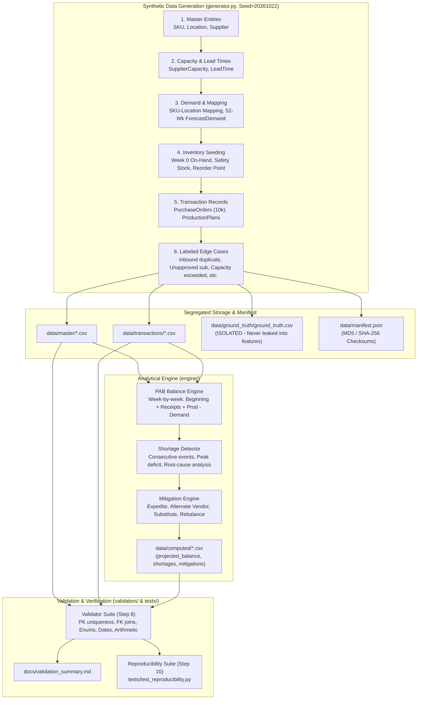

# Entity-Relationship & System Architecture Diagrams

This document visualizes the complete entity relationships and the data/execution pipeline for the YottaFlex Supply Chain Shortage Prioritization System.

---

## 1. Entity-Relationship Diagram (ERD)

The system models **11 core entities** with strict referential integrity, primary keys, foreign keys, and bridge tables for many-to-many associations.

```mermaid
erDiagram
    SKU ||--o{ FORECAST_DEMAND : "demanded across weeks"
    LOCATION ||--o{ FORECAST_DEMAND : "consumes demand"
    
    SKU ||--o{ INVENTORY : "stocked at"
    LOCATION ||--o{ INVENTORY : "stores stock"
    
    SUPPLIER ||--o{ SUPPLIER_CAPACITY : "offers capacity"
    SKU ||--o{ SUPPLIER_CAPACITY : "supplied by"
    
    SUPPLIER ||--o{ LEAD_TIME : "ships from"
    LOCATION ||--o{ LEAD_TIME : "receives at"
    
    SUPPLIER ||--o{ PURCHASE_ORDER : "fulfilled by"
    SKU ||--o{ PURCHASE_ORDER : "orders item"
    LOCATION ||--o{ PURCHASE_ORDER : "delivered to"
    
    SKU ||--o{ PRODUCTION_PLAN : "manufactures"
    LOCATION ||--o{ PRODUCTION_PLAN : "executed at plant"
    SKU ||--o{ PRODUCTION_PLAN : "requires BOM component"
    
    SKU ||--o{ SHORTAGE : "incurs shortage"
    LOCATION ||--o{ SHORTAGE : "experiences deficit"
    
    SHORTAGE ||--o{ MITIGATION_OPTION : "resolved by candidate"

    SKU {
        string sku_id PK "SKU-000001"
        string name
        string category
        string subcategory
        string uom
        float weight_kg
        float unit_cost
        string substitute_sku_id FK "Nullable FK to SKU"
        boolean substitute_approved
        string status "ACTIVE, DISCONTINUED, ON_HOLD"
        date created_at
    }

    LOCATION {
        string location_id PK "LOC-001"
        string name
        string type "WAREHOUSE, DISTRIBUTION_CENTER, PLANT"
        string region "North, South, East, West, Central"
        string country
        int capacity_units
        string status "ACTIVE, INACTIVE"
        float latitude
        float longitude
    }

    SUPPLIER {
        string supplier_id PK "SUP-000001"
        string name
        string country
        float reliability_score "0.0 to 1.0"
        string payment_terms "NET30, NET45, NET60, NET90"
        string status "ACTIVE, INACTIVE, SUSPENDED"
        boolean certified
        string specialization
    }

    SUPPLIER_CAPACITY {
        string supplier_capacity_id PK "SC-000001"
        string supplier_id FK "SUP-000001"
        string sku_id FK "SKU-000001"
        int max_weekly_capacity
        int min_order_qty
        string uom
        date effective_from
        date effective_to
        string status "ACTIVE, EXPIRED"
    }

    LEAD_TIME {
        string lead_time_id PK "LT-000001"
        string supplier_id FK "SUP-000001"
        string location_id FK "LOC-001"
        int transit_days
        string transport_mode "ROAD, RAIL, SEA, AIR"
        date effective_from
        date effective_to
    }

    FORECAST_DEMAND {
        string demand_id PK "DEM-SKU-000001-LOC-001-2026W01"
        string sku_id FK "SKU-000001"
        string location_id FK "LOC-001"
        int week "1 to 52"
        int year "2026"
        string week_label "2026W01"
        int quantity
        string uom
        float confidence "0.6 to 0.99"
        string demand_type "REGULAR, PROMOTIONAL"
        date created_at
    }

    INVENTORY {
        string inventory_id PK "INV-000001"
        string sku_id FK "SKU-000001"
        string location_id FK "LOC-001"
        int on_hand_qty
        int safety_stock_qty
        int reorder_point
        string uom
        date last_updated
        string status "AVAILABLE"
    }

    PURCHASE_ORDER {
        string po_id PK "PO-2026-000001"
        string supplier_id FK "SUP-000001"
        string sku_id FK "SKU-000001"
        string location_id FK "LOC-001"
        int quantity
        string uom
        date order_date
        date expected_delivery_date
        date actual_delivery_date "Nullable"
        string status "OPEN, CONFIRMED, IN_TRANSIT, RECEIVED, CANCELLED"
        float unit_cost
        float total_cost
        int week "Delivery week"
    }

    PRODUCTION_PLAN {
        string production_plan_id PK "PP-000001"
        string sku_id FK "SKU-000001"
        string location_id FK "LOC-001 (PLANT)"
        int week "1 to 52"
        int year "2026"
        int planned_quantity
        int actual_quantity "Nullable"
        string bom_sku_id FK "Component SKU"
        float bom_qty_per_unit
        float capacity_utilized_pct
        string status "PLANNED, IN_PROGRESS, COMPLETED, CANCELLED"
    }

    SHORTAGE {
        string shortage_id PK "SHORT-2026-000001"
        string sku_id FK "SKU-000001"
        string location_id FK "LOC-001"
        int first_shortage_week
        int last_shortage_week
        int duration_weeks
        int shortage_quantity
        int peak_shortage_week
        int peak_shortage_qty
        string severity "LOW, MEDIUM, HIGH, CRITICAL"
        float priority_score
        string root_cause "DEMAND_SPIKE, SUPPLY_DELAY, etc."
        string sku_category
        float sku_unit_cost
        date created_at
    }

    MITIGATION_OPTION {
        string mitigation_id PK "MIT-SHORT-2026-000001-01"
        string shortage_id FK "SHORT-2026-000001"
        string mitigation_type "EXPEDITE_PO, ALTERNATE_SUPPLIER, etc."
        string description
        int estimated_qty
        float estimated_cost_per_unit
        float estimated_total_cost
        int estimated_lead_time_days
        float feasibility_score "0.0 to 1.0"
        string risk_factors
        boolean recommended
        date created_at
    }

    STATE_TRANSITION_EVENT {
        string event_id PK "EVT-00000001"
        string entity_type "PurchaseOrder, ProductionPlan, Shortage"
        string entity_id FK "References target entity PK"
        string event_timestamp
        string from_state
        string to_state
        string actor_role "planner, supplier, carrier, operations"
        float quantity_impact
        string rationale
    }
```

---

## 2. End-to-End Execution Pipeline

The processing pipeline follows a unidirectional, reproducible flow. Ground truth anomalies are segregated from features to avoid data leakage.

